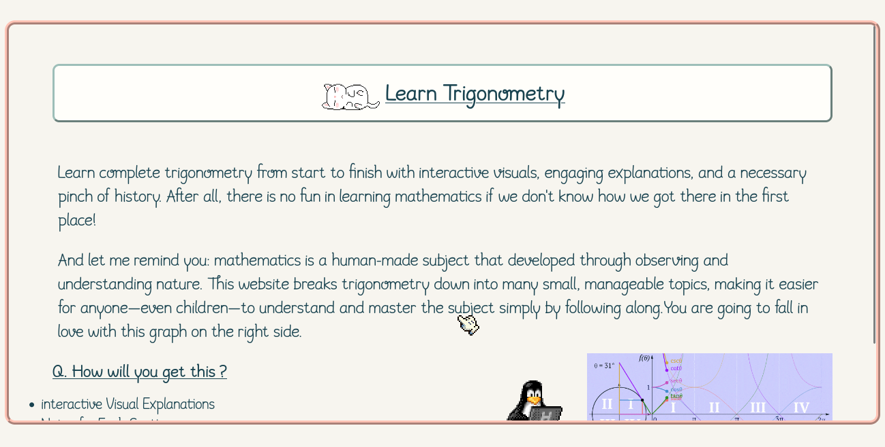

# Learn Trigonometry

## Website Look



## About

This website is made to help people learn Trigonometry from the very basics, starting with angles, sides, and the basics of triangles, all the way to advanced topics.

It's still a work in progress. There are plenty of chapters left to add, and what's available right now is just the beginning, with a few basic chapters to get you started.

It uses the **JSXGraph** library to display graphs, angles, and other interactive elements. This allows people to learn more smoothly by viewing and experimenting with the concepts right in front of them.

## Use Locally

This project uses npm. You can clone this repository and run it locally.

**1. Install the dependencies**

```bash
npm install
```

This will install the required dependencies, including Vite, which is used as the development server. You can then modify the code and see your changes in the browser.

**2. Start the development server**

```bash
npm run dev
```

If you're new to npm, you can learn its basics and then try running the project locally.

But if you don't want to deal with npm right now, I'd suggest trying it on GitHub Pages. It's already deployed there: [Website page](https://krish-saga.github.com/trigno).

## Fair Use

This project is licensed under the **MIT License**. Use it however you want. Just don't use it to scam people or misuse it. Other than that, feel free to distribute it, experiment with it, and learn from it!

## That's All!

I don't think there's anything left for you here. Go and try it out. Seriously, just go! : )
